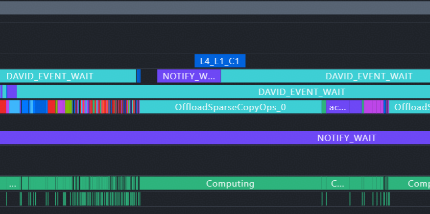

# CPU MoE profile 合成指南

目标是呈现下图这种 CPU 计算条形与 NPU 原始设备流并排阅读的效果，参考 `L4_E1_C1`，新增真实传输计数后为 `L4_E1_C1_T1`。截图用于说明展示方式；合成代码和图中重叠现象不构成模型正确性、计算精度或加速收益的证明。



原始参考入口：`/mnt/share/y50063808/vllm-ascend-workspace/cpu_moe/merge_cpu_compute_latest.sh`。本仓库 `scripts/` 保存加入校时和 T 标签的参考版本，原始包装器保存在 `reference/merge_cpu_compute_latest.original.sh`。新包装器要求显式给出同次 trace、CPU 日志和校时锚点，避免 latest 指向其他运行。

## 最小 CPU 计算采集

`run_dpark_26.sh` 中的 shell 条件开关是 `CPU_MOE_PHASE_TRACE=1`，它实际设置：

```bash
export KT_MOE_CPU_TRACE="$CAPTURE/cpu_compute_%p.jsonl"
export CPU_MOE_CLOCK_CALIBRATION=1
unset KT_MOE_LIFECYCLE_TRACE KT_MOE_LIFECYCLE_WORKERS KT_MOE_PHASE_TIMING
unset KT_MOE_TASK_TRACE KT_MOE_PAGE_TRACE KT_MOE_POLL_TRACE
unset VLLM_ASCEND_CPU_MOE_TRACE VLLM_ASCEND_PROFILE_DIAG_LOG
```

`CAPTURE` 使用本次任务专属目录，例如 `/mnt/share/y50063808/codex_logs/cpu_moe_profile/<时间>/`。该最小日志以 C++ CPU compute scope 的起止记录耗时，不开内部 worker、page、phase 细分诊断。它是作用域经过时间，包含该作用域内的等待，不是所有线程 CPU 用时之和，也不是 NPU 等待 CPU 的完整 roundtrip。实际边界是每个 part 的 forward_impl() 到返回；上层 merge_results() 的归约和输出类型转换、completion 通知、Python 返回与 H2D 不在该 span 内。完整 CPU 返回耗时需要额外外层计时，详见实施说明。

## 必须先对齐时钟

**CPU 与 NPU 可能使用不同的时钟域、起点和频率。直接将 CPU wall_ns 塞到 NPU trace 会造成错位，甚至制造虚假的并行与等待。** 原启动脚本开启旧校准变量，但原合成器没有应用时钟对齐；旧校准日志只有 CPU 包围区间，不能据此唯一还原设备时间。

新参考方案在同一 worker 中生成两类配对数据：profiler 的唯一 host marker，以及 CPU `CLOCK_MONOTONIC_RAW` 在 marker 入口前后的区间。通过首末锚点将 CPU RAW 映射到 profiler host 时域，并报告采样不确定性和漂移。该方案还依赖 Ascend exporter 已将 NPU device 时间映射到同一个 host 时域；如果原始 trace 的 host/device 自身未对齐，必须进一步取得它们的同步元数据，不能把 host marker 当成设备同步的替代。

接入方法见 [校时实现说明](../reference/CLOCK_ALIGNMENT_IMPLEMENTATION.md)。每个 worker PID 在真正开始采集后、最后一批计算完成且停止采集前分别调用 `clock_anchor_helper.record_clock_anchor('start', CAPTURE)` 和 `record_clock_anchor('stop', CAPTURE)`。`delay_iterations=2` 的原配置需要避免锚点落在未采集阶段；不能在开始前或 profiler 自动停止后再补标记。该 helper 的 import 必须发生在实际 worker 可访问的位置，而不是只在 API 前端调用。

合成器缺少配对锚点、锚点缺失或重复、时钟漂移异常或没有范围内 CPU 记录时会报错；常驻日志中锚点范围外的记录会排除并计数。不要移动 CPU 条形去适配 `NOTIFY_WAIT`，也不要把 wall clock 差值当成可靠的设备偏移。

## 同次输入与合成命令

等待 Ascend 解析成功并确认输出停止变化，选择：

1. 本次 `<ascend_pt>/ASCEND_PROFILER_OUTPUT/trace_view.json`。
2. 同 PID、同次运行的 `cpu_compute_<pid>.jsonl`。
3. 同次 worker 产生的 `cpu_clock_anchors_<pid>.jsonl`。可审查的生命周期接入补丁位于 `scripts/clock_anchor_profiler.patch`，启用 `CPU_MOE_CLOCK_ANCHORS=1`，详细应用步骤见实施说明。

```bash
bash scripts/merge_cpu_compute_latest.sh \
  "$TRACE" "$CPU_LOG" "$CLOCK_ANCHORS" "$OUT"
```

输出 `trace_view_cpu_compute.json`、`cpu_compute_stats.json`、`cpu_compute_report.txt`。也可以直接运行核心合成器，参数见 `--help`；多个 CPU 日志需要在校时 JSONL 中包含各 PID 的锚点。原始输入不要覆盖。使用 Perfetto 或兼容 Chrome trace 的查看器打开合成结果。

## 标签含义

| 字段 | 含义 |
|---|---|
| L4 | 显示层号，按当前合成器从零基 layer 加一显示。 |
| E1 | CPU compute 记录中的不同 CPU 专家数 expert_count；expert_ids_truncated 时可能不完整。 |
| C1 | CPU compute 记录的专家 route 数 expert_route_count，不是 CPU 核数。 |
| T1 | 该层本次按需准入迁入 NPU 的一个专家权重集合。T2 为两个。 |
| T0 | 日志明确记录本次按需迁入数为零。 |
| Tunknown | 旧日志没有 transfer_count，不能猜成零。 |

T 由 NPU 路由的 active.sum() 经 sentinel 传到 CPU 日志，重复 sentinel 取最大值而非求和。它不是字节数或 memcpy 次数，不包含独立预取，也不证明每次传输已经完成。查看独立预取需要对应日志另行说明。

## 合成后检查

检查 `actual_compute_spans`、`cpu_spans`、`unmatched_compute_spans` 和 `writer_status`，dropped 非零、无 CPU 记录或未匹配均应明确报告。检查校时斜率、锚点包围范围、不确定性及原始 NPU trace 的时钟同步前提，误差较大时不作微秒级结论。

导出只保留本次 CPU 计算窗口，窗口内原始设备、Python、CANN、draft、Overlap Analysis 流及事件保留；CPU actual compute 放在设备流附近上方。时间戳用 Decimal 处理，窗口内部事件保持原始 ts/dur，只有跨界事件精确裁剪，避免大绝对时间戳 float 舍入制造假重叠。裁剪窗口取本次已校时 CPU spans 与唯一匹配 roundtrip 的连续最早起点和最晚终点并集，保留匹配往返完整边界。

当前修改通过合成 fixture 验证 T 标签、时钟偏移映射、缺锚点拒绝与精确裁剪，尚未完成新采集的真机端到端验证。截图是目标效果，使用前仍须完成 worker 接入、真实采集和原始设备时钟映射核对。

## 覆盖完整 CPU 结果归并的可选补丁

现有最小开关只记录 part compute。若要求从外层 CPU 计算开始到 CPU 结果归并及类型转换完成，提供 `scripts/cpu_compute_total.patch` 供隔离环境审查与编译验证。该补丁增加 `KT_MOE_CPU_TRACE_KIND=total`，写 `cpu_moe.compute_total`，并关闭原 part span，避免重复计时。边界到外层 TP_MOE forward 内 merge_results 完成为止，仍不包含 Python 返回、completion 通知和设备侧结果使用。

应用并重新编译后启用：

```bash
export KT_MOE_CPU_TRACE_KIND=total
export KT_MOE_CPU_TRACE="$CAPTURE/cpu_compute_%p.jsonl"
# 采集完成并校时后，包装器显式选择新事件：
CPU_MOE_COMPUTE_EVENT=cpu_moe.compute_total \
  bash scripts/merge_cpu_compute_latest.sh "$TRACE" "$CPU_LOG" "$CLOCK_ANCHORS" "$OUT"
```

补丁尚未编译或真机验证，不能直接当作当前服务器已有能力。原有 `KT_DECODE_TIMING=1` / `KT_PREFILL_TIMING=1` 统计 submit 到 sync 的聚合时间，会混入排队，不等于这里的最小计算区间；`FORWARD_TIME_REPORT` 是编译期详细打印，也不作为本次最小采集开关。
